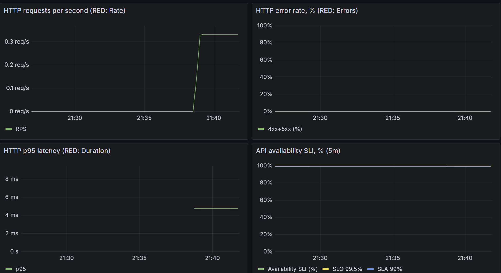
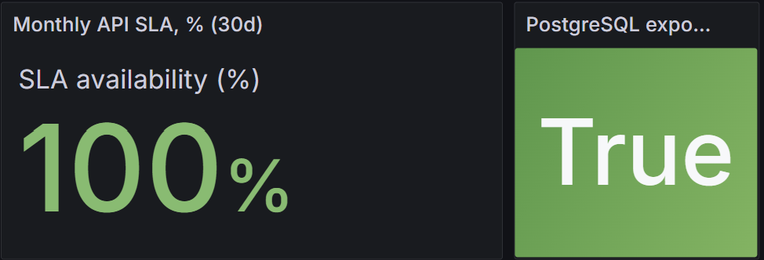
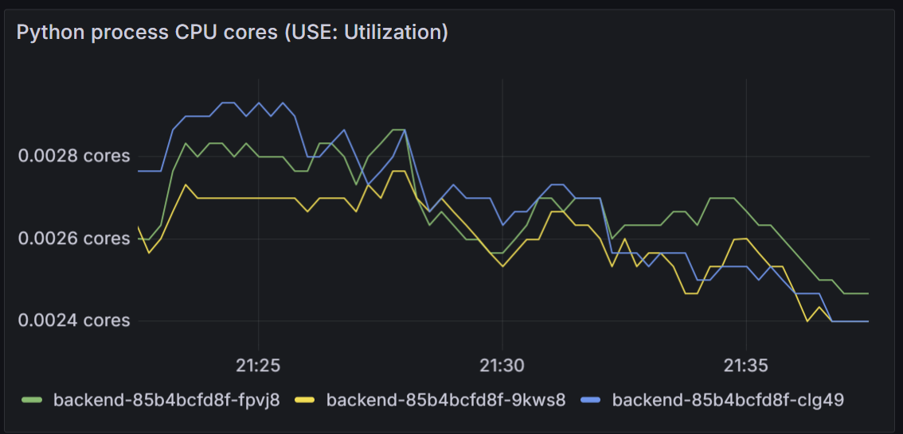
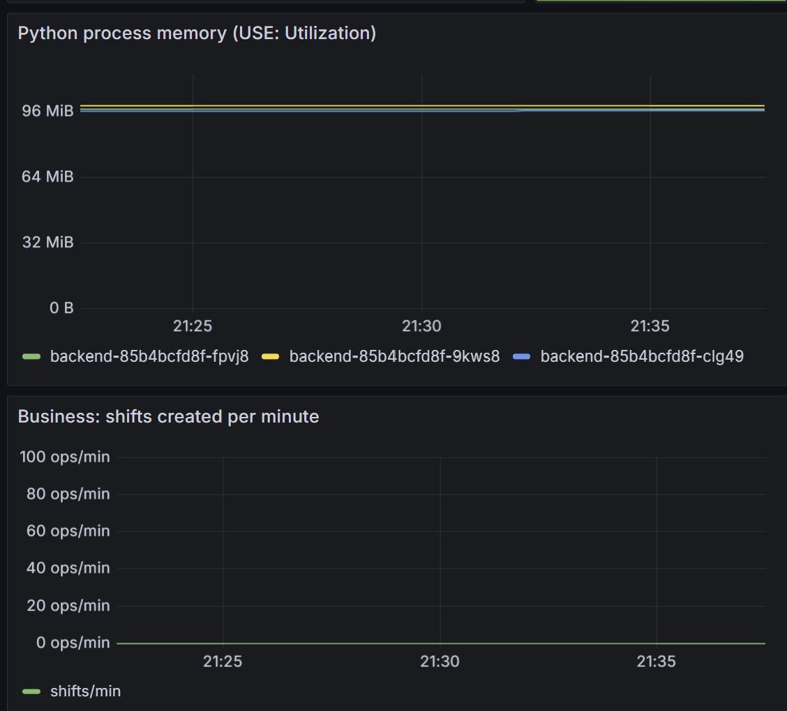
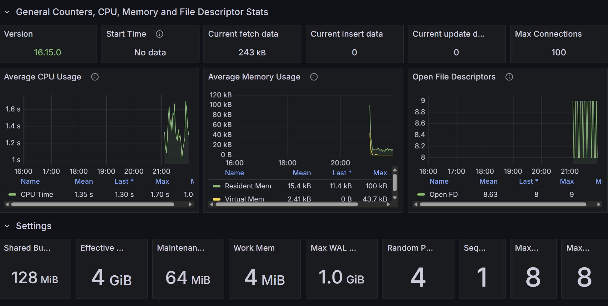
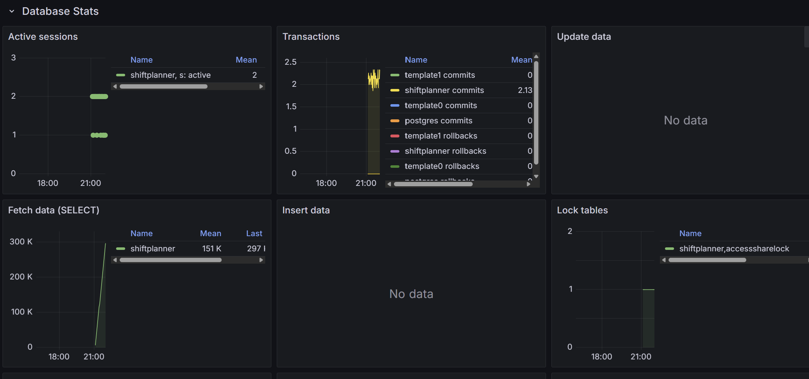

# Дашборды Grafana для ShiftPlanner

Скринкаст демонстрации дашбордов: [скринкаст-hw7.mp4](скринкаст-hw7.mp4).

## Стек и источники данных

ShiftPlanner — приложение на FastAPI и PostgreSQL. Backend публикует метрики на `/metrics`, а sidecar `postgres-exporter` — метрики PostgreSQL на порту `9187`. VictoriaMetrics собирает метрики с Pod приложения и exporter с интервалом 15 секунд. Grafana подключена к VictoriaMetrics как к Prometheus-совместимому источнику данных.

Datasource `VictoriaMetrics` использует внутренний адрес сервиса `vm-single-victoria-metrics-single-server` в namespace `monitoring`. Конфигурация Grafana находится в `grafana-values.yaml`; конфигурация сбора и PostgreSQL exporter — в `../k8s/victoria-metrics-values.yaml` и `../k8s/04-postgres.yaml`.

## Дашборд приложения

Экспортированный JSON дашборда: `dashboards/shiftplanner.json`.

| Панель | Назначение |
| --- | --- |
| HTTP requests per second | RPS пользовательских маршрутов — RED Rate. |
| HTTP error rate | Доля ответов 4xx и 5xx — RED Errors. Health-check и `/metrics` исключены. |
| HTTP p95 latency | 95-й перцентиль длительности запросов — RED Duration. |
| API availability SLI | Доля успешных 2xx запросов за 5 минут. На графике также показаны цели SLO 99.5% и SLA 99%. |
| Monthly API SLA | Доля успешных пользовательских запросов за последние 30 дней; порог 99%. Расчёт соответствует определению SLA в HW5. |
| PostgreSQL exporter up | Текущее состояние `pg_up`: `1` — exporter подключён к базе. |
| Python process memory | Память процесса backend по `process_resident_memory_bytes` — USE Utilization. |
| Python process CPU | CPU backend по скорости роста `process_cpu_seconds_total` — USE Utilization. |
| Shifts created per minute | Скорость создания смен по бизнес-счётчику `shiftplanner_shifts_created_total`. |

RED показывает скорость запросов, долю ошибок и задержку. CPU и память дают обзор использования ресурсов по USE. SLA вынесен в отдельную панель, чтобы его значение и порог были видны вместе с оперативными SLI.

Месячный SLA рассчитывается как `успешные пользовательские запросы 2xx / все пользовательские запросы × 100%`. Маршруты `/health`, `/health/db` и `/metrics` из пользовательского трафика исключены.

Для расчёта за 30 дней VictoriaMetrics настроена хранить samples 35 дней (`victoria-metrics-retention-values.yaml`). После изменения retention старые точки не появляются задним числом; полноценное месячное окно сформируется после 30 дней сбора. Поэтому текущее значение SLA на стенде следует рассматривать как результат доступной истории, а не как подтверждение полного календарного месяца.

Панели CPU и памяти backend показывают данные по трём репликам Python-сервиса. CPU отображается в ядрах, память — в MiB.

## Дашборд PostgreSQL Exporter

Импортирован community dashboard Grafana.com **PostgreSQL Database**, ID **9628**. Локальная версия находится в `dashboards/postgresql-database-9628.json`. Она использует datasource VictoriaMetrics; фильтры, зависящие от Helm label `release`, удалены, поскольку в нашем сборе таких labels нет. Выбор instance ограничен метрикой `pg_up` в namespace `shiftplanner`.

На дашборде видны версия PostgreSQL, текущие подключения, CPU и память exporter, транзакции, блокировки, объём чтения и записи и статистика checkpoint. В снимке обзора заполнены версия, лимит подключений, CPU, память и число открытых файловых дескрипторов.

